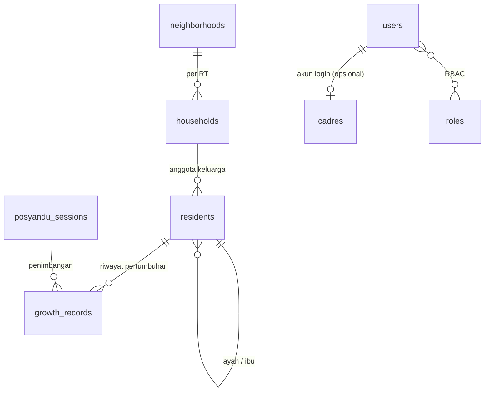

# Posyandu Sedap Malam

Sistem informasi **Posyandu Sedap Malam** (RW 11, Kelurahan Sukaluyu, Kecamatan Cibeunying Kaler, Kota Bandung). Terdiri dari dua bagian:

- **Website publik** (`/`): profil posyandu, alur pelayanan, jadwal imunisasi, tips kesehatan, galeri, struktur kader, FAQ, dan lokasi. Isinya dikelola lewat CMS.
- **Panel admin** (`/admin`): pendataan warga per RT, pencatatan penimbangan bulanan, grafik perkembangan anak, data kader, manajemen akun dan peran (RBAC), serta CMS website.

[](https://github.com/FazryJavier/Posyandu-SedapMalam/actions/workflows/ci.yml)

## Teknologi

| Bagian | Teknologi |
|---|---|
| Backend | PHP 8.4, Laravel 12 |
| Panel admin | Filament 4 (Livewire) |
| RBAC | spatie/laravel-permission + Filament Shield |
| Database | MySQL 8 (tes otomatis memakai SQLite in-memory) |
| Website publik | Blade, Bootstrap 5, template Arsha (BootstrapMade) |
| Pengujian | PHPUnit 11 |
| CI | GitHub Actions |

Panel admin memakai Filament, bukan AdminLTE, karena Filament sudah menyediakan CRUD, form, tabel, filter, grafik, otentikasi, dan RBAC siap pakai, sedangkan AdminLTE hanya tema HTML sehingga seluruh logika CRUD dan otorisasi harus ditulis manual.

## Prasyarat

- PHP 8.4 dengan ekstensi `mbstring`, `pdo_mysql`, `pdo_sqlite`, `intl`, `xml`, `fileinfo`, `bcmath`
- Composer 2
- MySQL 8 (atau MariaDB yang kompatibel)

## Memulai

```bash
git clone https://github.com/FazryJavier/Posyandu-SedapMalam.git
cd Posyandu-SedapMalam

composer install
cp .env.example .env
php artisan key:generate
```

Buat database kosong, lalu sesuaikan `DB_*` pada `.env` (bawaan: database `sedapmalam`, pengguna `root`, tanpa kata sandi):

```sql
CREATE DATABASE sedapmalam CHARACTER SET utf8mb4 COLLATE utf8mb4_unicode_ci;
```

Isi data super admin pertama di `.env` (hanya dibaca saat seeding, jangan di-commit):

```dotenv
ADMIN_NAME="Administrator"
ADMIN_EMAIL=admin@contoh.id
ADMIN_PASSWORD=ganti-dengan-kata-sandi-kuat
```

```bash
php artisan migrate --seed
php artisan storage:link
php artisan serve
```

- Website publik: <http://127.0.0.1:8000>
- Panel admin: <http://127.0.0.1:8000/admin> (masuk memakai `ADMIN_EMAIL` dan `ADMIN_PASSWORD`)

`--seed` membuat peran dan izin, akun super admin dari `.env`, serta mengisi CMS dengan teks bawaan dari `config/posyandu.php`. Seeder aman dijalankan ulang: data yang sudah ada tidak ditimpa dan kata sandi akun yang sudah ada tidak diubah. `storage:link` diperlukan agar foto galeri yang diunggah tampil.

> Jangan menjalankan `migrate:fresh`, `migrate:refresh`, atau `db:wipe` pada database yang berisi data nyata karena perintah tersebut menghapus seluruh tabel.

Pengguna Laragon dapat menyalakan MySQL dari Laragon, membuat database `sedapmalam`, lalu menjalankan perintah di atas.

## Peran dan hak akses (RBAC)

Izin dibuat otomatis oleh Filament Shield dengan format `Aksi:Entitas` (contoh `Update:Resident`). Akun tanpa peran, atau yang dinonaktifkan, tidak dapat membuka panel.

| Peran | Cakupan |
|---|---|
| `super_admin` | Seluruh fitur, termasuk mengelola peran dan izin (menu *Roles*) |
| `admin` | Mengelola RT/RW, keluarga, warga, kegiatan, kader, dan CMS; membuat dan mengubah akun, tanpa menghapus permanen dan tanpa mengubah peran |
| `cadre` | Mencatat keluarga, warga, dan penimbangan; hanya melihat RT/RW dan data kader; tidak dapat menghapus |
| `content_editor` | Hanya konten website (pengaturan, program, FAQ, galeri) dan melihat data kader |

Peran dapat disesuaikan di panel admin pada menu *Roles*. Matriks bawaan ada di `database/seeders/RolesAndPermissionsSeeder.php`.

## Struktur data

Data dibagi dua kelompok: **data warga** (RT, keluarga, warga, penimbangan) dan **data internal** (kader, akun, peran) ditambah **CMS** untuk konten website.



| Tabel | Isi |
|---|---|
| `neighborhoods` | RT/RW (unik per pasangan RW dan RT), ketua RT |
| `households` | Kartu Keluarga per RT: no. KK, alamat, air bersih, jamban sehat, bantuan sosial, jaminan kesehatan |
| `residents` | Semua anggota keluarga (kepala keluarga, pasangan, anak, orang tua, saudara, lainnya) dengan NIK, jenis kelamin, tanggal lahir, tautan ayah dan ibu, serta status (aktif, pindah, meninggal) |
| `posyandu_sessions` | Satu hari kegiatan posyandu (biasanya bulanan) |
| `growth_records` | Tabel penghubung kegiatan dan anak: berat, tinggi, lingkar kepala, lingkar lengan, usia (bulan), BMI. Satu anak hanya satu pengukuran per kegiatan |
| `cadres` | Direktori kader dan struktur organisasi (ketua, pengurus, kader seksi); dapat ditautkan ke akun login |
| `users`, `roles`, `permissions` | Akun admin dan RBAC |
| `site_settings`, `programs`, `faqs`, `gallery_items` | Konten website yang dikelola CMS |

Usia anak dan BMI (`berat / tinggi²`) dihitung otomatis saat pengukuran disimpan. Grafik perkembangan (BMI dan berat per bulan) tampil di halaman ubah data warga.

## Mengelola konten website (CMS)

Menu **Konten Website** pada panel admin:

- **Pengaturan Website**: tagline, jadwal, tentang kami, sasaran, visi, misi, alamat, dan kontak.
- **Program Kerja**, **FAQ**, **Galeri Foto**: tambah, ubah, urutkan, dan sembunyikan.
- **Kader** (menu Internal): data kader dengan opsi *Tampilkan di website* untuk organigram.

Konten dari database menggantikan nilai bawaan di [`config/posyandu.php`](config/posyandu.php). Bila database kosong atau tidak dapat dijangkau, website tetap tampil dari nilai bawaan tersebut.

## Menjalankan tes

```bash
php artisan test
```

Tes memakai SQLite in-memory (lihat `phpunit.xml`), sehingga tidak memerlukan MySQL dan tidak menyentuh database lokal. Cakupan: halaman publik dan CMS, skema, relasi dan aturan data, otorisasi per peran, serta form Filament (RT, keluarga, anggota keluarga, penimbangan, pengaturan website).

```bash
composer audit
```

## Continuous Integration

GitHub Actions ([`.github/workflows/ci.yml`](.github/workflows/ci.yml)) berjalan pada setiap pull request ke `main` dan push ke `main`: instalasi dependensi, `composer audit`, lalu `php artisan test` di PHP 8.4.

## Alur kontribusi

1. Buat branch dari `main`, misalnya `feat/nama-fitur`. Jangan commit langsung ke `main`.
2. Gunakan pesan commit [Conventional Commits](https://www.conventionalcommits.org/).
3. Pastikan `php artisan test` lulus, lalu buka pull request ke `main` dengan deskripsi perubahan dan hasil pengujian.

## Keamanan dan privasi

- NIK, nomor KK, dan data kesehatan anak adalah data pribadi. Batasi akses lewat peran, jangan membagikan ekspor data, dan jangan menaruh `.env` atau cadangan database di repositori.
- Kredensial super admin hanya dibaca dari `.env` saat seeding.
- Gunakan HTTPS dan kata sandi kuat di produksi, dan set `APP_DEBUG=false`.

## Kredit

- Template website publik: [Arsha](https://bootstrapmade.com/arsha-free-bootstrap-html-template-corporate/) oleh BootstrapMade.
- Panel admin: [Filament](https://filamentphp.com/) dan [Filament Shield](https://github.com/bezhanSalleh/filament-shield).
