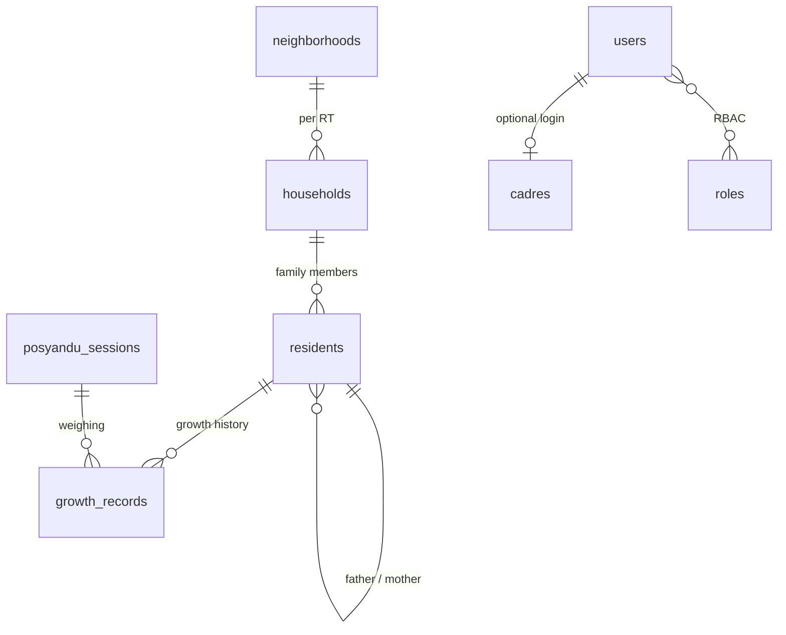

# Posyandu Sedap Malam

Information system for **Posyandu Sedap Malam** (RW 11, Sukaluyu, Cibeunying Kaler, Bandung). A *posyandu* is an Indonesian community health post for mothers and young children. The project has two parts:

- **Public website** (`/`): posyandu profile, service flow, immunization schedule, health tips, gallery, cadre organization chart, FAQ and location. Its content is managed through the CMS.
- **Admin panel** (`/admin`): household registration per RT (neighborhood unit), monthly weighing records, child growth charts, cadre directory, user accounts and roles (RBAC), and the website CMS.

[](https://github.com/FazryJavier/Posyandu-SedapMalam/actions/workflows/ci.yml)

> The public website and the admin UI are in Indonesian. Code, database schema and documentation are in English.

## Tech stack

| Area | Technology |
|---|---|
| Backend | PHP 8.4, Laravel 12 |
| Admin panel | Filament 4 (Livewire) |
| RBAC | spatie/laravel-permission + Filament Shield |
| Database | MySQL 8 (tests use in-memory SQLite) |
| Public website | Blade, Bootstrap 5, Arsha template (BootstrapMade) |
| Testing | PHPUnit 11 |
| CI | GitHub Actions |

**Why Filament instead of AdminLTE?** AdminLTE is only an HTML theme, so every CRUD screen, validation rule and authorization check would have to be hand-written. Filament ships ready-made CRUD, forms, tables, filters, charts, authentication and RBAC.

## Requirements

- PHP 8.4 with the `mbstring`, `pdo_mysql`, `pdo_sqlite`, `intl`, `xml`, `fileinfo` and `bcmath` extensions
- Composer 2
- MySQL 8 (or a compatible MariaDB)

## Getting started

```bash
git clone https://github.com/FazryJavier/Posyandu-SedapMalam.git
cd Posyandu-SedapMalam

composer install
cp .env.example .env
php artisan key:generate
```

Create an empty database and adjust the `DB_*` values in `.env` (defaults: database `sedapmalam`, user `root`, empty password):

```sql
CREATE DATABASE sedapmalam CHARACTER SET utf8mb4 COLLATE utf8mb4_unicode_ci;
```

Set the first super admin in `.env` (read only while seeding, never commit it):

```dotenv
ADMIN_NAME="Administrator"
ADMIN_EMAIL=admin@example.com
ADMIN_PASSWORD=use-a-strong-password
```

```bash
php artisan migrate --seed
php artisan storage:link
php artisan serve
```

- Public website: <http://127.0.0.1:8000>
- Admin panel: <http://127.0.0.1:8000/admin> (sign in with `ADMIN_EMAIL` and `ADMIN_PASSWORD`)

`--seed` creates roles and permissions, the super admin from `.env`, and fills the CMS with the default text from `config/posyandu.php`. The seeders are safe to re-run: existing rows are kept and the password of an existing account is never changed. `storage:link` is required so uploaded gallery photos are served.

If `ADMIN_EMAIL` / `ADMIN_PASSWORD` are empty, no admin is created. You can create one later with:

```bash
php artisan make:filament-user
php artisan shield:super-admin
```

> Do not run `migrate:fresh`, `migrate:refresh` or `db:wipe` against a database that holds real data. They drop every table.

Laragon users can start MySQL from Laragon, create the `sedapmalam` database and run the commands above.

## Roles and permissions (RBAC)

Permissions are generated by Filament Shield and named `Action:Entity` (for example `Update:Resident`). Accounts without a role, or deactivated accounts, cannot open the panel.

| Role | Scope |
|---|---|
| `super_admin` | Everything, including role and permission management (the *Roles* menu) |
| `admin` | Manages RT/RW, households, residents, sessions, cadres and the CMS; can create and edit accounts but cannot change roles or force-delete |
| `cadre` | Records households, residents and weighing; read-only access to RT/RW and cadre data; cannot delete |
| `content_editor` | Website content only (settings, programs, FAQ, gallery) plus read-only cadre data |

Roles can be adjusted in the panel under *Roles*. The default matrix lives in `database/seeders/RolesAndPermissionsSeeder.php`.

## Data model

Data is split into **resident data** (RT, households, residents, weighing) and **internal data** (cadres, accounts, roles), plus the **CMS** tables for the public website.



| Table | Contents |
|---|---|
| `neighborhoods` | RW/RT pairs (unique per RW and RT) and the RT head |
| `households` | One family card (KK) per RT: card number, address, clean water, sanitary toilet, social assistance, health insurance |
| `residents` | Every household member (head, spouse, child, parent, sibling, other) with NIK, gender, birth data, father/mother links and status (active, moved, deceased) |
| `posyandu_sessions` | One posyandu day (usually monthly) |
| `growth_records` | Junction between sessions and children: weight, height, head and arm circumference, age in months, BMI. A child has at most one measurement per session |
| `cadres` | Cadre directory and organization chart (leader, officers, section cadres); can be linked to a login account |
| `users`, `roles`, `permissions` | Admin accounts and RBAC |
| `site_settings`, `programs`, `faqs`, `gallery_items` | Public website content managed by the CMS |

A child's age and BMI (`weight / height²`) are computed automatically when a measurement is saved. The growth chart (BMI and weight per month) is shown on the resident edit page.

## Managing website content (CMS)

Under **Konten Website** in the admin panel:

- **Pengaturan Website** (site settings): tagline, schedule, about us, target audience, vision, mission, address and contact details.
- **Program Kerja**, **FAQ**, **Galeri Foto**: add, edit, reorder and hide items.
- **Kader** (under Internal): cadre records with a *show on website* option that feeds the organization chart.

Database content overrides the defaults in [`config/posyandu.php`](config/posyandu.php). If the CMS tables are empty, or the database is unreachable, the website still renders from those defaults.

## Running the tests

```bash
php artisan test
```

Tests run on in-memory SQLite (see `phpunit.xml`), so they need no MySQL and never touch your local database. They cover the public pages and CMS, the schema, relations and constraints, per-role authorization and the Filament form flows (RT, households, family members, weighing and site settings).

```bash
composer audit
```

## Continuous integration

GitHub Actions ([`.github/workflows/ci.yml`](.github/workflows/ci.yml)) runs on every pull request to `main` and every push to `main`: install dependencies, `composer audit`, then `php artisan test` on PHP 8.4.

## Contributing

1. Branch from `main`, for example `feat/short-description`. Do not commit directly to `main`.
2. Use [Conventional Commits](https://www.conventionalcommits.org/) for commit messages.
3. Make sure `php artisan test` passes, then open a pull request to `main` describing the change and how it was tested.

## Security and privacy

- NIK, family card numbers and children's health data are personal data. Restrict access through roles, do not share exports, and never commit `.env` files or database dumps.
- Super admin credentials are read from `.env` only while seeding.
- Use HTTPS and strong passwords in production, and set `APP_DEBUG=false`.

## Credits

- Public website template: [Arsha](https://bootstrapmade.com/arsha-free-bootstrap-html-template-corporate/) by BootstrapMade.
- Admin panel: [Filament](https://filamentphp.com/) and [Filament Shield](https://github.com/bezhanSalleh/filament-shield).
